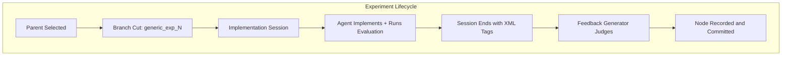
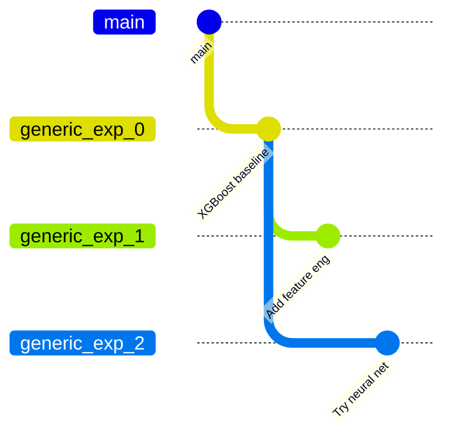

By default, a parent is chosen, a branch is cut, and a coding agent implements
the candidate and runs its evaluation in one session. The candidate branch and
judged result remain available for inspection. With
[cost-aware selection](/docs/evolve/cost-aware-selection), evaluation is deferred
until the finalized candidate passes an estimate-based cost check.



There is no separate debugging step: a failed evaluation surfaces in the session's tags, the judge marks the evaluation invalid or writes corrective feedback, and the **next** iteration addresses it.

## Git branch model

Each experiment runs in its own git branch, inheriting code from its parent experiment.



This enables:
- **Isolation**: Each experiment starts from a clean parent state
- **Inheritance**: Child experiments build on parent solutions
- **Versioning**: All code changes are tracked

## Experiment session

The `ExperimentSession` manages a single experiment:

```python
class ExperimentSession:
    def __init__(self, main_repo, session_folder, coding_agent_config, 
                 parent_branch_name, branch_name):
        # Clone repo to isolated folder
        self.repo = git.Repo.clone_from(main_repo, session_folder)
        
        # Checkout parent branch (inherit code)
        self.repo.git.checkout(parent_branch_name)
        
        # Create new experiment branch
        self.repo.git.checkout('-b', branch_name)
        
        # Initialize coding agent
        self.coding_agent = CodingAgentFactory.create(coding_agent_config)
```

## Default implementation flow

One session does the whole build. `run_implementation` renders the implementation prompt — the problem, the chosen solution, the knowledge context and the [repo memory](/docs/evolve/repo-memory) — and hands it to the coding agent with the budget's deadline:

```python
# In the generic strategy
branch_name = f"generic_exp_{node.node_id}"
session = workspace.create_experiment_session(branch_name, parent.branch_name)

node = run_implementation(solution, context, session)   # agent implements,
                                                        # builds and runs
                                                        # kapso_evaluation/,
                                                        # ends with XML tags

feedback = generate_feedback(node)                      # judge validates and
                                                        # decides stop/continue
```

The agent is responsible for running the evaluation itself and reporting the result in its closing tags (`<code_changes_summary>`, `<evaluation_script_path>`, `<evaluation_output>`, `<score>`, `<technical_difficulties>`). Errors are not retried inside the iteration; they become feedback for the next one.

## Cost-enabled implementation flow

When `search_strategy.params.cost.enabled` is true, the coding session builds
the candidate and prepares evaluation without running either. After the branch
is finalized and evaluator integrity is checked, the orchestrator estimates
the materialized candidate's platform cost. Kapso runs evaluation only if the
estimate passes the candidate cap and remaining campaign budget. The feedback
generator judges every finalized candidate: on the run's captured output when
a run happened, on the session's output for a build that errored. Only a
completed run can validate a score.

A refused candidate is recorded with `score = None`, an invalid evaluation,
and cost feedback for the next idea. It skips both internal evaluation and the
optional external iteration evaluator. Exceeding the remaining campaign
budget stops with `cost_budget_exhausted`. See
[Cost-aware selection](/docs/evolve/cost-aware-selection) for the contract,
accounting rules, and the limits of the build-only instruction.

## Result structure

Each experiment is recorded as a `SearchNode` — solution, branch, evaluation tags, judged feedback and score. The full field list is on the [search strategies page](/docs/evolve/search-strategies#node-structure-searchnode).

## Session finalization

After an experiment completes:

1. **Commit changes** to the experiment branch
2. **Push to origin** (available for child experiments)
3. **Record cost** from coding agent
4. **Cleanup** session folder

```python
def finalize_session(self, session):
    cost = session.get_cumulative_cost()
    self.previous_sessions_cost += cost
    session.close_session()  # commit, push, cleanup
```

The session folder is the only copy of the experiment's commits until the push succeeds. If origin rejects the push, `close_session()` raises `SessionPushError`, keeps the folder, and its message names the exact `git push` command that recovers the branch. Run that command before resuming: a resumed run rebuilds the node under the same branch name and replaces both the folder and the branch, so the recovered branch is for inspection or cherry-picking. A commit that fails for any reason other than an empty index (for example a pre-commit hook) also raises instead of being skipped.

## Related

<CardGroup cols={2}>
  <Card title="Execution flow" icon="diagram-project" href="/docs/evolve/execution-flow">
    The cycle around one experiment
  </Card>
  <Card title="Coding agents" icon="robot" href="/docs/evolve/coding-agents">
    Who writes the code
  </Card>
</CardGroup>

Related pages: [Execution flow](/docs/evolve/execution-flow) · [Coding agents](/docs/evolve/coding-agents) · [Orchestrator](/docs/evolve/orchestrator)

Kapso is an open-source engine by [Leeroo](https://leeroo.com) that runs experiments toward an objective, deploys the best solution and learns from every run. Source code: [github.com/Leeroo-AI/kapso](https://github.com/Leeroo-AI/kapso) · Install: `pip install leeroo-kapso` · Every page as plain text: [llms.txt](https://docs.leeroo.com/llms.txt).
