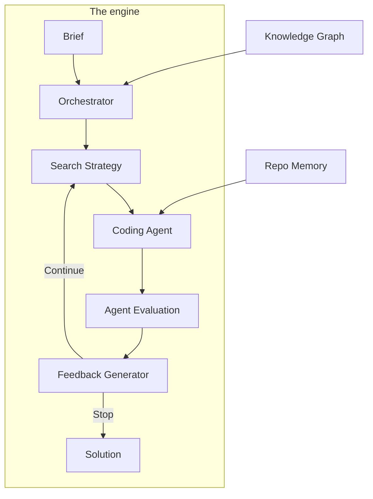

The engine behind `build()`: the experimentation loop. Give it a brief it can score and it runs a campaign: propose a candidate, implement it on its own git branch, evaluate it, judge the result, and repeat with what it learned, until the objective is met or the budget is spent.

## The tree of experiments

The loop is a set of specialised modules sharing one data structure, a tree of experiments. Each node records the hypothesis, the implementation (the git branch `generic_exp_N` and the technical difficulties the implementor met), the budget used, the score as the distance to the objective, the verdict and the judge's feedback, and its parent node. The modules read the tree and write back to it:

| Module | Reads | Writes |
|---|---|---|
| Ideation | Previous experiments (the tree's top, recent and similar nodes) and the bank of lessons | The new node's hypothesis: the core idea, how it differs from specific earlier experiments, which lessons it adopts. A reranker ranks the candidates by expected return against the target, weighed against time and budget |
| Implementation | The same context, plus the parent node's branch | The branch forked from the parent, the diff, the difficulties met, the evaluation output |
| Verification | The node's diff and evaluation output, the task's rules | The verdict: valid or void, with evidence |
| Feedback | The verdict, the evaluation and the success criteria | Whether the score is valid, whether the objective is met, and the feedback the next ideation reads |

Success criteria and tests can evolve during the run: a module proposes a justified change, and the verifier approves or rejects it ([Evaluation](/docs/build/evaluation)). The record of every node is on [Experiment lifecycle](/docs/evolve/experiment-lifecycle) and in [the trace](/docs/build/trace).

## How does a campaign work?



The system works by:

1. **Receiving a brief**: What you want to build, how it is measured, the target and the rules
2. **Initializing the repository**: From `repo`, a workflow search, or empty
3. **Gathering context**: From the experience the build loaded and repo memory
4. **Generating solutions**: Via pluggable coding agents
5. **Asking you when only you can help**: A session that needs a credential, access or a file only a person can provide records a request in the [inbox](/docs/build/inbox); the campaign pauses and your reply continues that same session
6. **Running evaluation**: Agent builds and runs evaluation in `kapso_evaluation/`
7. **Generating feedback**: Feedback generator validates results and decides stop/continue

## What are the pieces?

<CardGroup cols={2}>
  <Card title="Orchestrator" icon="sitemap" href="/docs/evolve/orchestrator">
    Central coordinator that manages the experimentation loop, budget tracking, and component lifecycle
  </Card>
  <Card title="Search Strategies" icon="magnifying-glass" href="/docs/evolve/search-strategies">
    The generic strategy: how candidates are generated, run and recorded
  </Card>
  <Card title="Coding Agents" icon="code" href="/docs/evolve/coding-agents">
    Pluggable code generators: Claude Code, Codex, Gemini, OpenHands and more
  </Card>
  <Card title="Feedback Generator" icon="comments" href="/docs/evolve/feedback-generator">
    Validates evaluation results and decides when to stop
  </Card>
  <Card title="Repo Memory" icon="brain" href="/docs/evolve/repo-memory">
    Tracks code understanding with file-level evidence
  </Card>
  <Card title="Inbox" icon="inbox" href="/docs/build/inbox">
    Where a session asks you for what only you can provide, and how your reply resumes it
  </Card>
</CardGroup>

## How do I run one?

```python
from kapso import Kapso, Budget

kapso = Kapso()

# A build with no evaluator: the campaign builds one from the brief
solution = kapso.build(
    "Build a random forest classifier for Iris with accuracy > 0.9",
    budget=Budget(experiments=10),
)

# With your evaluation and data, protected
solution = kapso.build(
    "Optimize model inference speed to < 10ms",
    evaluation="./my_evaluation/",   # copied to kapso_evaluation/
    data="./my_data/",               # copied to kapso_datasets/
    repo="https://github.com/org/starter",   # or a local path
)

# Deploy and run
deployed_program = kapso.deploy(solution, target="local")
result = deployed_program.run({"data_path": "./test.csv"})
```

## How do I start from an existing repo?

When `build()` is called, the system initializes the workspace:

| `repo` | Behavior |
|---------------------|----------|
| Local path | Use existing repository as starting point |
| GitHub URL | Clone repository and use as starting point |
| `None` (default) | Search for a relevant workflow in a loaded index. If found, clone its repository. Otherwise, start from an empty repository. |

## Configuration

One configuration ships, the packaged `config.yaml`, and an override file of
yours changes what you name in it. The gates off, for a quick experiment, is
such a file:

```yaml
# minimal.yaml
search_strategy:
  params:
    ideation:
      gates: []
    implementation:
      gates: []
```

```python
solution = Kapso(config="minimal.yaml").build("...")
```

See [Configuration](/docs/reference/configuration).

Each experiment runs on its own Git branch (`generic_exp_N`), so attempts stay isolated and every one can be checked out later — see [Experiment lifecycle](/docs/evolve/experiment-lifecycle).

### Workspace structure

After setup, the workspace looks like:

```text
workspace/
├── kapso_evaluation/     # Agent builds evaluation here
│   └── evaluate.py       # Evaluation script
├── kapso_datasets/       # Data files (from data)
├── .kapso/
│   └── repo_memory.json  # Codebase understanding
└── (solution code)       # From repo, or agent-built
```

## What does a campaign remember?

Evolve uses two memory systems:

### Repo memory

Tracks understanding of the codebase:
- **Architecture** — High-level structure and patterns
- **Key Claims** — Important facts about the code
- **File Evidence** — Which files support each claim

### Experiment history

Learns from past experiments via MCP tools:
- **Top Experiments** — Best scoring experiments
- **Recent Experiments** — Most recent experiments
- **Similar Experiments** — Semantic search for related experiments

## How do I bound a campaign?

The Orchestrator tracks costs across all components:

```python
# Get cumulative cost
cost = orchestrator.get_cumulative_cost()
print(f"Total cost: ${cost:.2f}")
```

Budget limits are set with `Budget(minutes, experiments, usd, reserve_minutes)` on the call or in the brief, or in configuration.

## Related

<CardGroup cols={2}>
  <Card title="Architecture" icon="building" href="/docs/evolve/architecture">
    Deep dive into system architecture
  </Card>
  <Card title="Execution Flow" icon="arrow-progress" href="/docs/evolve/execution-flow">
    Detailed walkthrough of the execution process
  </Card>
  <Card title="Search Strategies" icon="tree" href="/docs/evolve/search-strategies">
    How tree search and linear search explore solutions
  </Card>
  <Card title="Experiment Lifecycle" icon="rotate" href="/docs/evolve/experiment-lifecycle">
    Lifecycle of a single experiment
  </Card>
</CardGroup>

Related pages: [Orchestrator](/docs/evolve/orchestrator) · [Search Strategies](/docs/evolve/search-strategies) · [Coding Agents](/docs/evolve/coding-agents) · [Feedback Generator](/docs/evolve/feedback-generator) · [Repo Memory](/docs/evolve/repo-memory) · [Architecture](/docs/evolve/architecture) · [Execution Flow](/docs/evolve/execution-flow) · [Experiment Lifecycle](/docs/evolve/experiment-lifecycle)

Kapso is an open-source engine by [Leeroo](https://leeroo.com) that runs experiments toward an objective, deploys the best solution and learns from every run. Source code: [github.com/Leeroo-AI/kapso](https://github.com/Leeroo-AI/kapso) · Install: `pip install leeroo-kapso` · Every page as plain text: [llms.txt](https://docs.leeroo.com/llms.txt).
