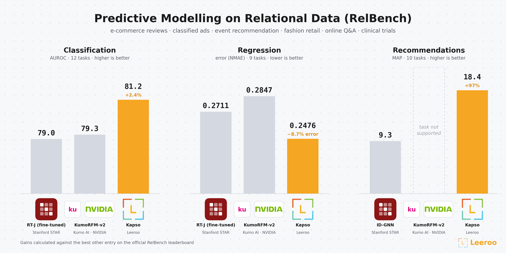
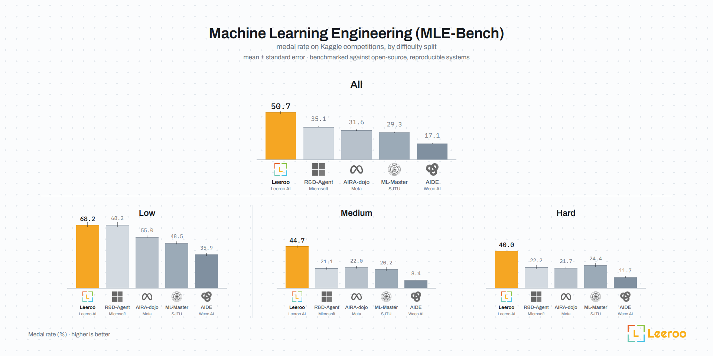
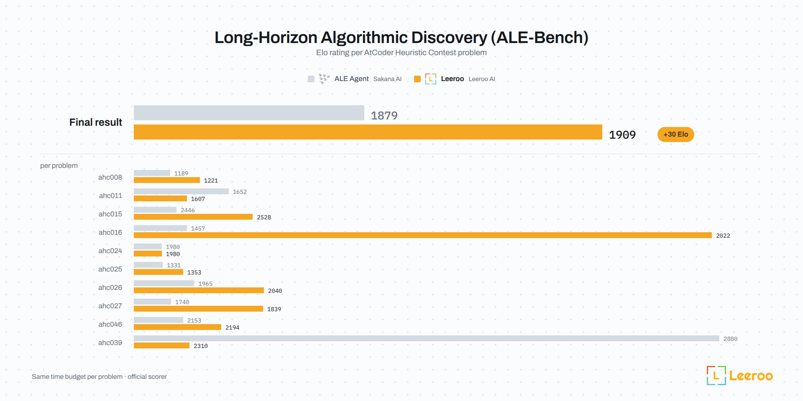

<!-- Brazilian Portuguese translation of README.md, generated with scripts/translate_readme.py (Claude Code). Keep it in step: README.md and this file change in the same commit, and scripts/check_readme_translations.py fails when a link, a number or a line of code differs. -->
<h1 align="center">Kapso</h1>

<h4 align="center">Um motor que executa experimentos, implanta a melhor solução e aprende com cada execução</h4>
<p align="center"><sub>experimentação inteligente · aprendizado · implantação · adaptação de domínio</sub></p>

<div align="center">
<!-- translations:start -->
<details><summary><b>Read this in other languages</b></summary>

<a href="../../README.md">English</a> | <a href="README.zh-CN.md">简体中文</a> | <a href="README.ja-JP.md">日本語</a> | <a href="README.ko-KR.md">한국어</a> | <a href="README.de-DE.md">Deutsch</a> | <a href="README.fr-FR.md">Français</a> | <a href="README.es-ES.md">Español</a> | <a href="README.hi-IN.md">हिन्दी</a> | <b>Português</b> | <a href="README.ru-RU.md">Русский</a> | <a href="README.zh-TW.md">繁體中文</a>

</details>
<!-- translations:end -->
</div>

<p align="center">
  <a href="https://docs.leeroo.com/docs">Saiba mais</a> ·
  <a href="https://www.youtube.com/watch?v=W4FHlza1fRs">Veja a demo</a> ·
  <a href="https://discord.gg/hqVbPNNEZM">Entre no Discord</a> ·
  <a href="https://leeroo.com">Site</a>
</p>

<p align="center">
  <a href="https://pypi.org/project/leeroo-kapso/"></a>
  <a href="https://discord.gg/hqVbPNNEZM"></a>
  <a href="https://github.com/leeroo-ai/kapso"></a>
  <a href="https://www.ycombinator.com/companies/leeroo"></a>
</p>

<p align="center">
  Se você gosta deste projeto, apoie-nos dando uma estrela ⭐
</p>

<p align="center">
  <a href="https://github.com/Leeroo-AI/kapso/raw/main/docs/images/kapso-hero.mp4">
    
  </a>
</p>

> **Se você é um agente de IA olhando este repositório:** o plugin do Kapso, com as skills para
> configurar, declarar um objetivo, escrever um harness e revisar uma execução, instala-se
> em uma linha: `claude plugin marketplace add Leeroo-AI/kapso && claude plugin install kapso@kapso`
> (Codex: `codex plugin marketplace add Leeroo-AI/kapso && codex plugin add kapso@kapso`).

---

## Novidades

- **IOAI 2026 · a trilha de Modelos de IA.** A [Olimpíada Internacional de IA](https://ioai-official.org) é a IMO da era da IA: 471 competidores, seis tarefas projetadas por especialistas, um orçamento de uma única GPU. Sua trilha [IOAI²](https://ioai-official.org/ai-model-track/) de 2026 deu a sistemas de IA a mesma prova em uma sessão autônoma. O Kapso, um dos 14 Participantes Fundadores de IA, marcou 536.07 na correção dos organizadores, acima de todos os competidores humanos, e levou o Troféu Grand Master do IOAI², top 3 entre os sistemas de IA inscritos. [Resultados completos →](../../benchmarks/ioai2026/README.md) · [A análise da IOAI sobre a trilha →](https://ioai-official.org/what-happens-when-autonomous-ai-takes-on-the-same-tasks-as-the-worlds-top-young-ai-talents/)
- **Primeiro em todos os três leaderboards do [RelBench](../../benchmarks/relbench/README.md).** No benchmark de Stanford para ML preditivo sobre dados relacionais, o Kapso lidera o [leaderboard oficial](https://star-project.stanford.edu/relbench/leaderboard/) em classificação (81.2 de AUROC contra 79.3 do [KumoRFM-v2](https://docs.nvidia.com/sdgm/rfm/overview) e 79.0 do [RT-J](https://star-project.stanford.edu/rt-j) do Stanford STAR), regressão (0.2476 de NMAE contra 0.2711 e 0.2847) e recomendações (18.4 de MAP contra 9.3 do ID-GNN, a melhor outra entrada).

  <p align="center"></p>

- **[Leeroopedia](https://leeroopedia.com)**: nosso banco de lições público nos domínios de dados e ML, cerca de 100k páginas extraídas experimentando sobre artigos e repositórios, atendendo cerca de 6M de requisições por mês, cerca de 28% delas de agentes de IA. As sessões do Kapso o consultam via MCP durante a ideação e a implementação.
- **#1 no [MLE-Bench](../../benchmarks/mle/README.md)**: o KAPSO alcançou a primeira colocação entre os sistemas open-source em competições de ML do Kaggle (MLE Benchmark).

  <p align="center"></p>

- **#1 no [ALE-Bench](../../benchmarks/ale/README.md)**: o KAPSO alcançou a primeira colocação em problemas de descoberta algorítmica de longo horizonte (ALE Benchmark).

  <p align="center"></p>

## O que é o Kapso?

O Kapso é um motor open-source que executa experimentos, implanta a melhor solução e aprende com cada execução. Ele parte de um harness de domínio e de um banco de lições vazio e, dados um objetivo e critérios de sucesso, ele:

- **executa uma árvore de experimentos**: propõe hipóteses e, em seguida, implementa e verifica cada uma;
- **implanta a melhor solução** na stack de destino;
- **aprende com a execução**: o crédito vai para cada hipótese e implementação conforme seu impacto no resultado, e o banco é atualizado, com cada lição carregando uma pontuação de credibilidade e uma fronteira de onde ela se aplica.

Com o tempo, o harness de domínio passa a carregar um banco de lições: as melhores práticas experimentadas daquele ambiente. O Kapso é agnóstico a modelo e a agente de codificação, feito pela [Leeroo](https://leeroo.com), publicado no PyPI como [`leeroo-kapso`](https://pypi.org/project/leeroo-kapso/).

### As quatro partes

| Parte | Verbo | O que faz |
|------|------|--------------|
| [**Experimentação inteligente**](https://docs.leeroo.com/docs/build/brief) | `.build()` | Cada experimento é uma hipótese implementada em seu próprio branch e pontuada, em uma árvore. A ideação se apoia em experimentos anteriores e no banco de lições e reordena as ideias pelo retorno esperado em relação ao orçamento, para que se ajustem a este ambiente em vez das ideias genéricas de um LLM puro ou de um RAG; um avaliador com fingerprint que nenhum experimento pode tocar verifica o resultado, e os módulos podem propor atualizações da avaliação para o verificador aprovar. [Como funciona →](https://docs.leeroo.com/docs/evolve/overview) |
| [**Aprendizado**](https://docs.leeroo.com/docs/learn/what-learn-produces) | `.learn()` / `.load_experience()` | Cada lição é induzida ou deduzida a partir de traces de experimentação e carrega uma pontuação de credibilidade, uma fronteira de onde ela se aplica e suas evidências; `learn()` as atualiza a partir do resultado de cada execução e faz um teste A/B de cada mudança reconstruindo com e sem ela, de modo que a melhoria é medida, não adivinhada. O banco é construído sobre git: `kapso experience share`, `list` e `update`. [Experience →](https://docs.leeroo.com/docs/experience) nomeia o que é servido a um build. |
| [**Implantação**](https://docs.leeroo.com/docs/deploy/targets) | `.deploy()` | Uma experimentação mais curta do mesmo tipo adapta a melhor solução à stack de destino, implanta-a e comprova os health checks e uma chamada funcionando. Docker, Modal, BentoCloud e LangGraph Platform vêm inclusos; um harness pode adicionar um destino. |
| [**Adaptação de domínio**](https://docs.leeroo.com/docs/harnesses) | `kapso harness` | Um harness é o pacote de domínio do Kapso: o conhecimento e os fluxos de trabalho de uma área, como modelagem preditiva, para que um build nunca comece do zero, e onde o banco de lições se acumula. Modelagem preditiva e programação competitiva vêm inclusas; escreva o seu com `/kapso:harness` no plugin ou `kapso harness` na CLI. |

## 🚀 Início rápido

<p align="center">
  <a href="https://www.youtube.com/watch?v=W4FHlza1fRs">
    
  </a>
  <br><sub>▶ Assista à apresentação antes de instalar</sub>
</p>

### Instalação

**0. Em um agente de codificação?** Instale o plugin do Kapso e deixe que ele percorra os
passos abaixo com você:

```bash
claude plugin marketplace add Leeroo-AI/kapso && claude plugin install kapso@kapso   # Claude Code
codex plugin marketplace add Leeroo-AI/kapso && codex plugin add kapso@kapso         # Codex
```

Em seguida, `/kapso:setup` instala e verifica, e `/kapso:build <what you want>`
lança a primeira campanha (no Codex: `$kapso-setup`, `$kapso-build <what you want>`). Veja [O plugin do Kapso](https://docs.leeroo.com/docs/coding-agent-skills).

**1. Pré-requisitos.** O Kapso executa sua inferência por meio das CLIs de agentes de codificação
(não há fallback de API direta), então você precisa do Node.js e de ambas as CLIs
de agente logadas antes que qualquer coisa funcione:

```bash
# Node.js 18+ (https://nodejs.org), depois:
npm install -g @openai/codex            # pesquisa, julgamento, utilitários
codex login

npm install -g @anthropic-ai/claude-code  # ideação + implementação (o host padrão)
claude auth login
```

Uma chave da OpenAI é opcional: apenas o grafo de conhecimento e a busca semântica
sobre experimentos passados (`models.embedding` na sua config) geram embeddings de texto, e
a geração nunca a usa. Quando você ativar qualquer um dos dois:

```bash
echo 'OPENAI_API_KEY=sk-...' >> .env
```

**2. Conecte a Leeroopedia (recomendado).** Uma chave dá a cada sessão a
[Leeroopedia](https://leeroopedia.com), nosso banco de lições hospedado sobre frameworks de ML e
IA. Nada a instalar; uma conta nova no
[painel da Leeroopedia](https://app.leeroopedia.com/dashboard) vem com
$20 de crédito gratuito.

```bash
echo 'LEEROOPEDIA_API_KEY=kpsk_...' >> .env
```

**3. Instale o pacote** (Python 3.10+):

```bash
pip install leeroo-kapso
```

**4. Verifique a configuração:**

```bash
kapso doctor
```

`doctor` informa o que **a sua config** realmente precisa e nomeia a correção exata
para qualquer coisa que falte. Os requisitos seguem a config, então uma configuração
só com codex nunca é cobrada por `claude`. Restrinja a um verbo para ver apenas os
requisitos daquele verbo:

```bash
kapso doctor build             # ou learn / deploy / experience
```

Essas são as mesmas verificações que o próprio verbo executa antes de fazer qualquer trabalho:
`kapso.build(...)` falha em segundos por uma CLI ausente, em vez de falhar no fundo
de uma sessão. Itens marcados com `[-- ]` são opcionais; eles limitam recursos
de que você talvez não precise (docker, Weaviate, Neo4j, os destinos de deploy).

**Ou deixe seu agente de codificação fazer tudo isso:** cole o
[prompt de setup](https://docs.leeroo.com/docs/installation#set-up-through-your-coding-agent)
no Claude Code, no Codex ou no OpenCode.

**Os armazenamentos de que um índice precisa (opcional)**: `kapso experience add --repo`
e `--research` ingerem um corpus em Weaviate + Neo4j locais. A partir de um
checkout do código-fonte:

```bash
bash scripts/start_infra.sh   # inicia ambos via docker
```

**A partir do código-fonte (para desenvolvimento)**

```bash
git clone https://github.com/leeroo-ai/kapso.git
cd kapso

conda create -n kapso python=3.12 && conda activate kapso
pip install -e .
```

O adaptador legado do aider é um extra (`pip install "leeroo-kapso[aider]"`,
Python <3.13); os agentes padrão claude/codex não precisam de extras.

### Uso básico

Os verbos principais não precisam de nada além dos pré-requisitos acima:

```python
from kapso import Kapso, Budget

kapso = Kapso()   # nenhum grafo de conhecimento é necessário para começar

# Build: uma solução por meio de experimentação. A campanha imprime
# `status: <path>` no lançamento; acompanhe ao vivo de outro terminal com
#     kapso watch ./campaign
# Se uma sessão precisar de algo que só você pode fornecer (uma chave de API, um arquivo),
# a campanha pausa e `kapso inbox reply` a retoma:
#     https://docs.leeroo.com/docs/build/inbox
# Compartilhe o resultado como Markdown para um pull request ou issue com
#     kapso report ./campaign -o report.md
solution = kapso.build(
    "Optimize the model in train.py; target accuracy > 0.80 on evaluate.py",
    repo="./my_project",                 # ou omita para começar do zero
    output="./campaign",
    budget=Budget(minutes=120),
)
print(solution.explain())

# Aprenda com a campanha que você acabou de executar: minere a trajetória, avalie as
# lições e guarde no banco cartões de conhecimento precificados por evidência. O banco (um
# repositório git local) é criado automaticamente no primeiro uso; as lições ficam na sua
# máquina até que você as compartilhe:
#     kapso experience share <git-url>
# depois disso, cada learn() envia o banco para lá.
lesson = kapso.learn(solution)
print(lesson.explain())

# Faça o build de novo, servido com os cartões que ele acabou de conquistar: um build recebe
# exatamente a experiência que carrega.
kapso.load_experience("mine")
solution2 = kapso.build("...", output="./campaign2")
```

Com os armazenamentos em execução, você também pode ingerir conhecimento externo em um
índice e servi-lo da mesma forma:

```python
from kapso import Kapso

kapso = Kapso()

# Uma vez: um repositório, ou a web pesquisada para uma pergunta, em um índice
kapso.add_experience(repo="https://github.com/huggingface/trl", name="trl")
kapso.add_experience(research="RLHF and DPO fine-tuning for legal contract analysis", name="dpo-legal")

# Todo build que carrega o índice o pesquisa; a Leeroopedia vem com a sua chave
kapso.load_experience("trl")
kapso.load_experience("leeroopedia")
solution = kapso.build("Fine-tune Llama-3.1-8B for clause risk classification")
```

Uma observação sobre orçamento: uma ingestão extrai tudo o que o material sustenta.
Uma única pergunta pode virar dezenas de páginas interligadas e uma ingestão de
várias horas; o tempo de ingestão escala com a substância extraível, então adicione as
fontes que você vai pesquisar, não todas as fontes que você tem.

E para transformar uma solução em software em execução:

```python
software = kapso.deploy(solution, target="local")   # ou docker, modal, bentoml, langgraph, auto
result = software.run(software.proof["inputs"])     # a chamada que a implantação comprovou
software.stop()
```

### Como limito uma campanha?

Use `max_iterations`, `time_budget_minutes` e `cost_budget` para limitar iterações, tempo decorrido e gasto com modelos em USD, em regime de melhor esforço.
Para custos de plataforma, habilite a [seleção sensível a custo](https://docs.leeroo.com/docs/evolve/cost-aware-selection) em `search_strategy.params.cost` com seu estimador, `cap_per_candidate` e `campaign_budget`; seu `weight` também permite que a seleção prefira candidatos mais baratos.

### Escolhendo os modelos

Todo modelo que o Kapso usa é nomeado em um único arquivo de config. O padrão empacotado
roda as sessões de build em `claude-opus-5`, as equipes de aprendizado em
`claude-fable-5` e os papéis do codex em `gpt-5.6-sol`, mas o acesso aos modelos
depende da assinatura (um plano pode limitar um modelo enquanto serve outro).
Para rodar com modelos diferentes, copie a config empacotada, edite e aponte
o Kapso para a sua:

```python
from pathlib import Path
import yaml
from kapso import Kapso
from kapso.kapso import DEFAULT_CONFIG_PATH

config = yaml.safe_load(Path(DEFAULT_CONFIG_PATH).read_text())
# ex.: rode as equipes de aprendizado em opus em vez de fable:
crews = yaml.safe_dump(config).replace("claude-fable-5", "claude-opus-5")
Path("kapso-config.yaml").write_text(crews)

kapso = Kapso(config="kapso-config.yaml")
```

Papéis de inferência somente texto podem optar por Chat Completions `openai_compatible`.
Defina o modelo e o endpoint na sua config; as credenciais ficam no ambiente.
Carregue a config com `Kapso(config=...)` ou `kapso build --config ...`.
Codificação e pesquisa na web ainda exigem agentes com as ferramentas correspondentes.
Veja o [exemplo de configuração e os limites](https://docs.leeroo.com/docs/evolve/coding-agents#openai-compatible-api).

Antes de uma execução longa, sonde cada modelo que a sua config nomeia contra as suas
assinaturas reais: um modelo que o seu login não consegue servir falha aqui em
segundos, em vez de horas dentro de uma execução. Um limite de uso em um modelo que você
consegue servir não é visível para uma sondagem de um token:

```bash
kapso doctor --models                            # config empacotada
kapso doctor --models --config kapso-config.yaml # a sua
kapso doctor learn --models                      # apenas as equipes de aprendizado
```

Para tornar essa sondagem parte de cada chamada, em vez de algo que você precisa lembrar de
rodar, ative-a na sua config. Ela custa um token descartável por par
`{cli, model}` distinto, o que vale a pena antes de um `learn()` de várias horas
sem supervisão:

```yaml
preflight:
  enabled: true            # verificações estáticas antes de cada verbo (padrão)
  live_model_probe: true   # + sondagens de modelo de um token (padrão: false)
```

Trocas de modelo mudam o *ritmo* também: os limites `timeout_minutes` das equipes na
config foram calibrados nos modelos padrão, e um modelo trocado que
raciocina por mais tempo pode precisar que eles sejam aumentados.

Para passos detalhados de integração, veja os guias de [Início rápido](https://docs.leeroo.com/docs/first-build) e [Instalação](https://docs.leeroo.com/docs/installation).

## Benchmarks suportados

| Benchmark | Descrição |
|-----------|-------------|
| [**MLE-Bench**](../../benchmarks/mle/README.md) | O benchmark de engenharia de ML da OpenAI: competições completas em dados tabulares, visão, texto e áudio, dos dados brutos à submissão avaliada |
| [**ALE-Bench**](../../benchmarks/ale/README.md) | O benchmark de otimização algorítmica da Sakana AI: projetar, implementar e iterar heurísticas de competição ao longo de buscas de várias horas |
| [**RelBench**](../../benchmarks/relbench/README.md) | O benchmark de Stanford para ML preditivo sobre dados relacionais: classificação, regressão e recomendação direto dos bancos de dados multitabela da Amazon, H&M, Stack Exchange, ensaios clínicos e mais |
| [**IOAI 2026**](../../benchmarks/ioai2026/README.md) | ML de olimpíada cronometrada em visão, linguagem e otimização: tarefas definidas por especialistas, hardware de competição, zero ajuda humana |

Cada benchmark também tem uma página de documentação cobrindo como executá-lo, suas opções de CLI e o que a saída contém:
[IOAI 2026](https://docs.leeroo.com/docs/benchmarks/ioai-2026) ·
[MLE-Bench](https://docs.leeroo.com/docs/benchmarks/mle-bench) ·
[ALE-Bench](https://docs.leeroo.com/docs/benchmarks/ale-bench) ·
[RelBench](https://docs.leeroo.com/docs/benchmarks/relbench)

## Exemplos

Cada exemplo é uma tarefa: um brief, um repositório inicial, os dados ou como obtê-los, e um driver de no máximo doze linhas; [examples/README.md](../../examples/README.md) tem os minutos e o único comando.

| Exemplo | A tarefa |
|---------|----------|
| [**Engenharia de dados (modelos dbt no Snowflake)**](../../examples/dbt-snowflake/README.md) | Corrigir os modelos dbt com problemas de qualidade de dados e construir os novos que um backlog de dezessete tickets pede, em um warehouse de varejo no Snowflake, até que cada ticket passe em seus testes de produção; depois entregar um pull request por ticket e liberá-los em produção. |
| [**Otimização do harness (agente de suporte ao cliente)**](../../examples/support-agent-harness/README.md) | Otimizar o harness de um agente de suporte ao cliente para trocar o LLM subjacente do Fable 5.1 por um Qwen 27B local sem perder resolução nas conversas com clientes, depois implantá-lo em Docker e aprender com a execução. |
| [**Modelagem preditiva (churn de clientes)**](../../examples/churn-first-build/README.md) | Prever quais clientes vão sair: elevar o ROC AUC fora da amostra de um modelo de churn em direção à meta, sob um avaliador que a campanha não pode editar. |
| [**Detecção de fraude**](../../examples/fraud-no-evaluator/README.md) | Pontuar transações quanto a fraude quando o repositório não tem avaliador: o brief declara o protocolo, a campanha constrói o avaliador primeiro e depois melhora o pontuador. |
| [**Finanças quantitativas**](../../examples/trading/README.md) | Uma estratégia de trading diária sobre instrumentos sintéticos: elevar o Sharpe fora da amostra no harness de trading, com suas verificações em cada tentativa. Um exemplo de pesquisa, não aconselhamento financeiro. |
| [**ML tabular**](../../examples/end-to-end/README.md) | Uma competição do Kaggle de ponta a ponta: Spaceship Titanic de um classificador dummy a um modelo real, depois review, learn, build de novo com a lição, e deploy. |
| [**Otimização de PyTorch**](../../examples/torch-performance/README.md) | Tornar um módulo PyTorch mais rápido em CUDA dentro de uma tolerância numérica: fusão, compilação, menos tráfego de memória. |
| [**Otimização de kernels de GPU**](../../examples/gpu-kernels/README.md) | Acelerar a self-attention multi-head em CUDA com flash attention ou um kernel Triton, dentro de uma tolerância numérica. |

## 📚 Documentação e suporte

- **Documentação completa**: [docs.leeroo.com](https://docs.leeroo.com/docs)
  - [Instalação](https://docs.leeroo.com/docs/installation): as CLIs de agentes de codificação, o pacote e `kapso doctor`
  - [Início rápido](https://docs.leeroo.com/docs/first-build): sua primeira campanha
  - [Referência da CLI](https://docs.leeroo.com/docs/reference/cli): cada comando, flag e padrão
  - [API Python](https://docs.leeroo.com/docs/reference/kapso-api): cada método público de `Kapso`
  - [Configuração](https://docs.leeroo.com/docs/reference/configuration): cada chave em `config.yaml`
  - [O que learn produz](https://docs.leeroo.com/docs/learn/what-learn-produces): o banco de lições, cada uma com uma pontuação de credibilidade, uma fronteira e suas evidências, e o [modo de desenvolvimento](https://docs.leeroo.com/docs/learn/development-mode)
  - [Experimentação inteligente](https://docs.leeroo.com/docs/evolve/overview): a árvore de experimentos e seus módulos, e [o que acontece dentro de um experimento](https://docs.leeroo.com/docs/evolve/execution-flow)
  - [Experience](https://docs.leeroo.com/docs/experience): seu banco, a Leeroopedia, repositórios e artigos transformados em conhecimento pesquisável
  - [Deploy](https://docs.leeroo.com/docs/deploy/targets): local, Docker, Modal e os outros destinos
  - [O plugin do Kapso](https://docs.leeroo.com/docs/coding-agent-skills): os comandos, as skills e o servidor MCP para Claude Code, Codex e Cursor
- **A partir do seu agente de codificação**: a documentação roda um servidor MCP em `https://docs.leeroo.com/mcp`, e cada página é servida como Markdown; veja [llms.txt](https://docs.leeroo.com/llms.txt) e [Kapso no seu agente de codificação](https://docs.leeroo.com/docs/coding-agent-skills).
  ```bash
  claude mcp add --transport http kapso-docs https://docs.leeroo.com/mcp   # Claude Code
  codex mcp add kapso-docs --url https://docs.leeroo.com/mcp              # Codex CLI
  ```
- **Deixe seu agente de codificação executar o Kapso**: o plugin em [`plugin/`](https://github.com/Leeroo-AI/kapso/tree/main/plugin) traz dez comandos, seis skills e o servidor MCP, uma linha de instalação por host (passo 0 acima); o OpenCode carrega as skills como uma pasta (`ln -s <clone>/plugin/skills .opencode/skills`). Veja [O plugin do Kapso](https://docs.leeroo.com/docs/coding-agent-skills).
- **Dê ao seu agente de codificação as ferramentas de conhecimento do Kapso**: `kapso-mcp`, instalado com o pacote, serve pesquisa na web, a memória do repositório, o histórico de experimentos da campanha e o banco de lições à sessão em que você trabalha; veja [gates MCP](https://docs.leeroo.com/docs/evolve/mcp-gates#use-the-gates-from-your-own-coding-agent).
  ```bash
  claude mcp add kapso -- kapso-mcp   # Claude Code
  codex mcp add kapso -- kapso-mcp    # Codex CLI; depois `startup_timeout_sec = 60` em [mcp_servers.kapso] no ~/.codex/config.toml (os dez segundos do Codex são curtos em uma máquina ocupada)
  ```
- **Comunidade**: [Discord](https://discord.gg/hqVbPNNEZM)
- **Site**: [leeroo.com](https://leeroo.com)


## Kapso para empresas

Na empresa, os agentes do Kapso vêm com harnesses iniciais de engenharia de dados e de IA e um banco de lições, e transformam objetivos de negócio em sistemas de IA e de dados funcionais por conta própria, investigando os artefatos, repositórios, pipelines, fontes de dados e mais da companhia, para construir o patrimônio de dados da empresa à medida que avançam. Para adotar o Kapso nas tarefas da sua empresa, [fale conosco](https://leeroo.com/contact-us).

## Contribuindo

Contribuições são bem-vindas! Veja nosso [Guia de Contribuição](../../CONTRIBUTING.md) para detalhes sobre como começar.

## Contribuidores

<a href="https://github.com/Leeroo-AI/kapso/graphs/contributors">
  
</a>

Feito com [contrib.rocks](https://contrib.rocks).
